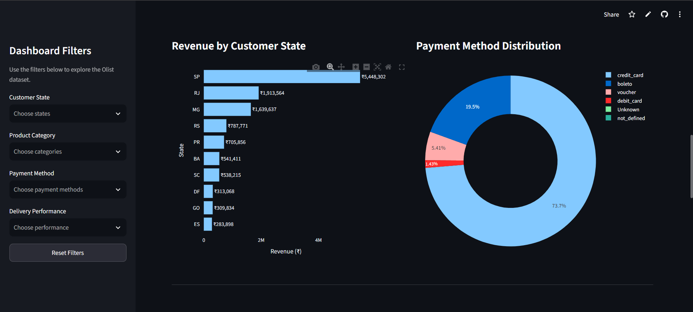
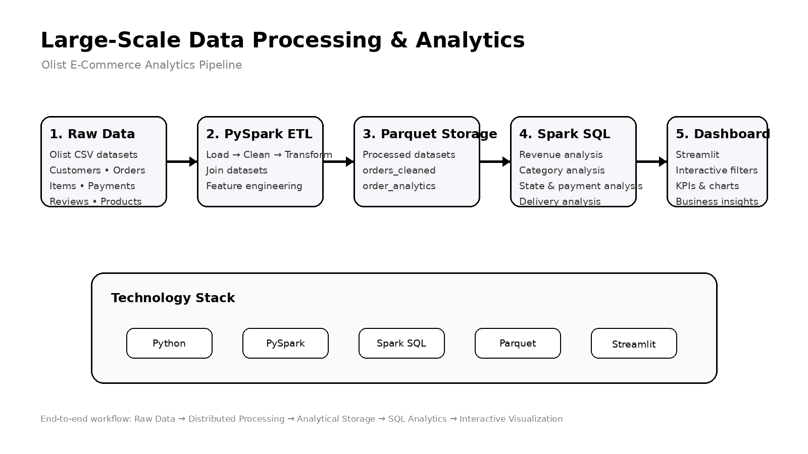

# Large-Scale E-Commerce Data Processing & Analytics

A large-scale e-commerce data processing and analytics project built using **Python, PySpark, SQL, Parquet, Pandas, Plotly, and Streamlit**.

The project uses the **Olist Brazilian E-Commerce Public Dataset** to build an end-to-end data pipeline that loads raw CSV data, cleans and transforms order information with PySpark, stores processed data in Parquet format, performs analytical queries with Spark SQL, and presents the results through an interactive Streamlit dashboard.

---

## Live Dashboard

Explore the interactive dashboard built with Streamlit:

[](YOUR_STREAMLIT_APP_URL)

---

## Project Overview

The goal of this project is to demonstrate an end-to-end workflow for processing and analyzing a large structured e-commerce dataset.

The pipeline covers:

- Data loading with PySpark
- Data cleaning and transformation
- Delivery-time and delivery-performance analysis
- Joining orders, customers, products, order items, and payment data
- Parquet-based processed data storage
- Spark SQL analytics
- Revenue and product-category analysis
- Customer-state analysis
- Payment-method analysis
- Delivery-performance analysis
- Interactive Streamlit visualization

---

## Key Insights

The analysis of the Olist Brazilian E-Commerce dataset provides insights into
order performance, revenue, and delivery operations.

- **Order Volume:** The dataset contains 99,441 orders.
- **Revenue:** The analytics pipeline calculates total revenue of approximately
  R$ 14.21 million.
- **Delivery Performance:** Delivery analysis helps identify orders delivered
  on time, delayed orders, and orders with unavailable delivery information.
- **Customer and Order Analysis:** The pipeline combines customer, order,
  payment, review, and order-item data to support business analysis.
- **Data Processing:** PySpark is used to clean, transform, and process the
  dataset, while SQL is used for analytical queries.

These insights are presented through the interactive Streamlit dashboard.

---

## Architecture

```text
                    Olist E-Commerce Dataset
                              │
                              ▼
                     ┌─────────────────┐
                     │   Raw CSV Data  │
                     │ Customers       │
                     │ Orders          │
                     │ Order Items     │
                     │ Products        │
                     │ Payments        │
                     │ Reviews         │
                     │ Geolocation     │
                     └────────┬────────┘
                              │
                              ▼
                     ┌─────────────────┐
                     │     PySpark     │
                     │ Data Loading    │
                     │ Cleaning        │
                     │ Transformation  │
                     │ Joins           │
                     └────────┬────────┘
                              │
                              ▼
                     ┌─────────────────┐
                     │ Processed Data  │
                     │     Parquet     │
                     └────────┬────────┘
                              │
                              ▼
                     ┌─────────────────┐
                     │    Spark SQL    │
                     │ Revenue         │
                     │ Categories      │
                     │ States          │
                     │ Payments        │
                     │ Delivery        │
                     └────────┬────────┘
                              │
                              ▼
                     ┌─────────────────┐
                     │ Streamlit App   │
                     │ KPIs            │
                     │ Charts          │
                     │ Filters         │
                     │ Data Summary    │
                     └─────────────────┘
```

A visual version of the architecture is also included in the project as `docs/architecture.png`.

---

## Dataset

The project uses the **Olist Brazilian E-Commerce Public Dataset**.

The dataset contains multiple related tables, including:

- Customers
- Orders
- Order Items
- Products
- Payments
- Reviews
- Sellers
- Geolocation

The main analytical workflow combines order-level information with customer, product, order-item, and payment information.

---

## Project Structure

```text
large-scale-data-processing-analytics/
│
├── data/
│   ├── raw/
│   │   └── Olist CSV datasets
│   │
│   └── processed/
│       ├── customers/
│       ├── orders_cleaned/
│       ├── order_analytics/
│       └── sql_results/
│
├── src/
│   ├── 01_load_customers.py
│   ├── 02_load_all_data.py
│   ├── 03_clean_orders.py
│   ├── 04_create_order_analytics.py
│   ├── 05_create_order_analytics.py
│   └── 06_sql_analytics.py
│
├── docs/
│   └── architecture.png
│
├── app.py
├── requirements.txt
├── README.md
└── .gitignore
```

> The exact script names can be adjusted if the local project contains additional or differently numbered processing scripts.

---

## Data Processing Pipeline

### 1. Data Loading

PySpark is used to load the Olist CSV datasets into Spark DataFrames.

The project loads data such as:

- Customers
- Orders
- Order Items
- Payments
- Reviews
- Geolocation

The loaded datasets are inspected using Spark schemas and row counts.

---

### 2. Data Cleaning

The order data is cleaned and transformed using PySpark.

Important derived fields include:

- `delivery_days`
- `delivery_delay_days`
- `delivery_performance`

The delivery performance classification is used to identify orders as:

- **On Time**
- **Late**
- **Unknown**

---

### 3. Processed Parquet Data

After transformation, the processed data is stored in **Parquet** format.

Example:

```text
data/processed/orders_cleaned/
data/processed/order_analytics/
```

Parquet provides a columnar storage format suitable for analytical workloads.

The processed order dataset currently contains **99,441 rows**.

---

## SQL Analytics

Spark SQL is used to perform analytical queries on the processed dataset.

The project calculates:

### Total Revenue

Current processed result:

```text
₹14,209,250.31
```

### Revenue by Product Category

The analysis calculates revenue and order-item counts for each product category.

Examples of high-revenue categories in the current result include:

- beleza_saude
- relogios_presentes
- cama_mesa_banho
- esporte_lazer
- informatica_acessorios

### Revenue by Customer State

Revenue and order-item counts are analyzed by Brazilian customer state.

### Payment Method Analysis

Payment methods are analyzed using order-item counts and average price.

Methods include:

- credit_card
- boleto
- voucher
- debit_card
- not_defined

### Delivery Performance

The current processed analytics contain:

```text
On Time : 107,507 order items
Late    :   7,530 order items
Unknown :   3,397 order items
```

### Late Delivery Analysis

The SQL analytics also calculate:

- Number of late orders
- Average delay
- Maximum delay

Current result:

```text
Late orders:          7,530
Average delay:        10.57 days
Maximum delay:       188 days
```

---

## Streamlit Dashboard

The project includes an interactive Streamlit dashboard.

The dashboard provides:

### KPI Cards

- Total Revenue
- Order Items
- Unique Orders
- Average Order Value
- Late Delivery Rate

### Interactive Filters

Users can filter the dashboard by:

- Customer State
- Product Category
- Payment Method
- Delivery Performance

### Visualizations

The dashboard includes:

1. Monthly Revenue Trend
2. Top 10 Product Categories by Revenue
3. Revenue by Customer State
4. Payment Method Distribution
5. Delivery Performance
6. Average Delivery Days
7. Customer State Summary Table

A filtered dataset can also be downloaded as CSV.

---

## Technology Stack

| Technology | Purpose |
|---|---|
| Python | Application and data processing |
| PySpark | Large-scale data processing |
| Spark SQL | Analytical queries |
| Parquet | Processed data storage |
| Pandas | Dashboard data handling |
| Plotly | Interactive visualizations |
| Streamlit | Interactive dashboard |
| Java | Spark runtime |
| Git/GitHub | Version control and project hosting |

---

## Environment Setup

The project uses a Python virtual environment named:

```text
large_data
```

Activate it on Windows:

```powershell
.\large_data\Scripts\activate
```

Install dependencies:

```powershell
pip install -r requirements.txt
```

---

## Running the Pipeline

Run the processing scripts in sequence according to the project workflow.

For example:

```powershell
python src/01_load_customers.py
python src/02_load_all_data.py
python src/03_clean_orders.py
python src/05_create_order_analytics.py
python src/06_sql_analytics.py
```

The scripts generate processed Parquet datasets under:

```text
data/processed/
```

---

## Running the Dashboard

After the processed datasets have been generated:

```powershell
python -m streamlit run app.py
```

The application will normally be available at:

```text
http://localhost:8501
```

---

## Key Results

The current pipeline produces approximately:

| Metric | Result |
|---|---:|
| Customers | 99,441 |
| Orders | 99,441 |
| Order Items | 112,650 |
| Revenue used in analytics | ₹14,209,250.31 |
| On-Time Order Items | 107,507 |
| Late Order Items | 7,530 |
| Unknown Delivery Items | 3,397 |
| Maximum Delivery Delay | 188 days |

The dashboard currently works from the processed analytics dataset and supports interactive filtering.

---

## Why This Project Matters

This project demonstrates more than basic data visualization. It combines:

**Data Engineering**

- Distributed processing with PySpark
- Data cleaning
- Multi-table joins
- Derived analytical fields
- Parquet storage

**Data Analytics**

- Spark SQL
- Aggregations
- Revenue analysis
- Customer-state analysis
- Payment analysis
- Delivery analysis

**Data Visualization**

- Interactive KPIs
- Plotly charts
- Filtering
- Dashboard summaries
- CSV export

This makes the project suitable for demonstrating practical skills in **data engineering, data analytics, SQL, and Python-based visualization**.

---

## Future Improvements

Possible future enhancements include:

- Automated pipeline execution
- Incremental data processing
- More advanced delivery-delay analysis
- Customer segmentation
- RFM analysis
- Seller performance analysis
- Product-level profitability analysis
- Dashboard deployment
- Automated data-quality checks
- Unit tests for transformation scripts

---

## Author

**Gourab Saha**

B.Tech — Computer Science and Business System

Technologies demonstrated in this project:

`Python` `PySpark` `SQL` `Parquet` `Pandas` `Plotly` `Streamlit`

## Live Dashboard

[Open the Interactive Streamlit Dashboard](YOUR_STREAMLIT_URL)

## Dashboard Preview


## Project Architecture



## Key Insights

- Total revenue: ₹14.21 million.
- Total order items: 118,434.
- Unique orders: 99,441.
- Average order value: ₹142.89.
- Late delivery rate: 6.55%.

## Technologies Used

- Python
- PySpark
- SQL
- Parquet
- Streamlit
- Plotly

## Project Features

- Data loading and processing.
- Data quality checks.
- ETL pipeline using PySpark.
- SQL-based analytical queries.
- Interactive dashboard with filters.
- Revenue and delivery performance analysis.

## Run Locally

```bash
pip install -r requirements.txt
streamlit run app.py
```